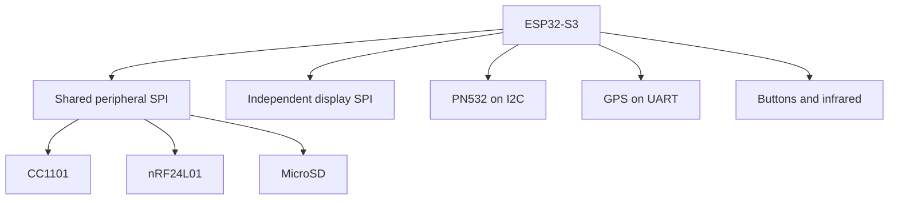

# ESP32-S3 Multi-Protocol Embedded Device

**A custom handheld build integrating an ILI9341 display, two radio transceivers, NFC, GPS, infrared, and MicroSD around an ESP32-S3.**

[Hardware & pin map](CUSTOM_HARDWARE.md) · [Board integration](docs/BOARD_INTEGRATION.md) · [Build & validation](docs/VALIDATION.md) · [Upstream Bruce](https://github.com/BruceDevices/firmware)

| MCU | Display | Firmware base | Custom target |
| --- | --- | --- | --- |
| ESP32-S3 N16R8 | ILI9341, 240 × 320 | Bruce 1.15-derived source | `esp32s3-dilen` |

## Project focus

This repository documents **Dilen's physical hardware integration and custom board support** for the open-source Bruce firmware. The original firmware, interface, and feature implementations are credited to the [Bruce project and its contributors](UPSTREAM_README.md).

The engineering work centers on pin allocation, shared-bus integration, board configuration, module bring-up, and two-button navigation.

## Custom contributions

- A dedicated PlatformIO environment, board definition, and pin header for the ESP32-S3 N16R8.
- **Three peripherals on one SPI bus:** CC1101, nRF24L01, and MicroSD, with independent chip selects.
- An independent SPI bus for the display.
- PN532 over I2C and GPS over UART, plus infrared input/output.
- Two physical buttons with software debounce and short/long-press actions.
- Board-specific configuration defaults and migration from earlier radio pin settings.

## System architecture



## Hardware at a glance

| Peripheral | Interface | Project role |
| --- | --- | --- |
| ILI9341 | Dedicated SPI | 240 × 320 display; touch disconnected |
| CC1101 | Shared SPI + GDO0 | Sub-GHz radio integration |
| nRF24L01 | Shared SPI + CE | 2.4 GHz radio integration |
| MicroSD | Shared SPI | Removable storage |
| PN532 | I2C | NFC module |
| NEO-M7 | UART, 9600 baud | GPS receiver |
| IR transmitter / receiver | GPIO | Infrared input and output |
| Two buttons | GPIO with pull-ups | Next, select, and back |

### Shared SPI allocation

| Signal | ESP32-S3 GPIO |
| --- | ---: |
| SCK | 12 |
| MOSI | 11 |
| MISO | 13 |

| Device | Chip select | Additional signal |
| --- | ---: | --- |
| CC1101 | 10 | GDO0 = 9 |
| nRF24L01 | 17 | CE = 16 |
| MicroSD | 21 | — |

Inactive CS/CSN lines remain high. CC1101 and nRF24L01 use 3.3 V power and logic. See the [complete pin reference](CUSTOM_HARDWARE.md) for display, power, UART, I2C, infrared, and button connections.

## Build

Install PlatformIO, then:

```bash
git clone https://github.com/dilen1997/Bruce-ESP32S3-Dilen-Custom.git
cd Bruce-ESP32S3-Dilen-Custom
pio run -e esp32s3-dilen
```

The project scripts define a merged output named `Bruce-esp32s3-dilen.bin`. Use a freshly built image matching the current source and pin map. The repository does not include a verified prebuilt image for this maintenance revision.

[Build and validation notes](docs/VALIDATION.md) distinguish source configuration from hardware test evidence. Existing [Hebrew flashing notes](FLASH_INSTRUCTIONS_HE.md) are retained as historical setup guidance.

## Navigation

| Input | Action |
| --- | --- |
| GPIO38 button | Next |
| Short press on GPIO39 | Select |
| Hold GPIO39 for 800 ms | Back |

Both buttons connect to GND and use internal pull-ups.

## Repository guide

| Path | Purpose |
| --- | --- |
| `boards/ESP32S3-Dilen/` | Custom environment, pin map, and board interface |
| `boards/_boards_json/esp32s3-dilen.json` | Board memory and upload definition |
| `src/`, `include/`, `lib/` | Bruce firmware and dependencies |
| `CUSTOM_HARDWARE.md` | Complete wiring reference |
| `docs/` | Integration and validation notes |
| `UPSTREAM_README.md` | Preserved upstream documentation and credits |

## Scope and responsible use

Module presence and menu availability do not establish that every upstream feature has been tested on this custom board. This documentation update does not change radio behavior or claim a fresh full-firmware build. Use radio and security-testing functions only on systems you own or are authorized to test, subject to applicable rules.

## Credits & license

- Original firmware: **Bruce project and contributors** — [upstream repository](https://github.com/BruceDevices/firmware).
- Custom hardware assembly and board integration: **Dilen Guerchon**.
- Firmware license: [GNU AGPL v3.0](LICENSE). Preserve upstream attribution and provide corresponding source when distributing covered binaries.

[View the engineering portfolio](https://github.com/dilen1997/Smart-Charge-Manager/blob/main/docs/PORTFOLIO.md)
